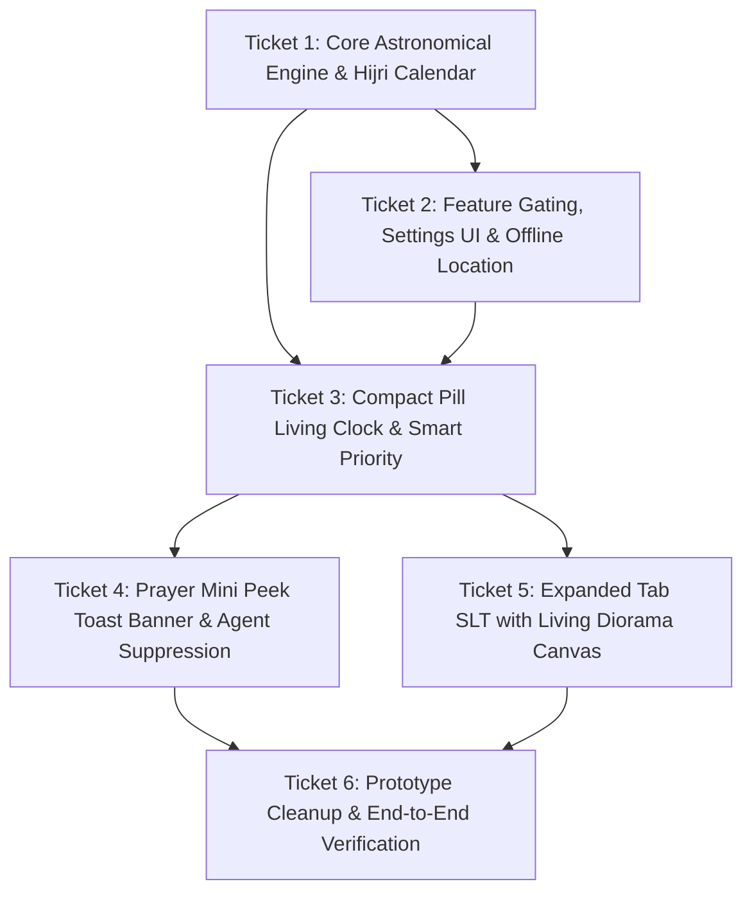

# Implementation Tickets: Prayer Times & Living Diorama Clock

**Specification Reference:** [`docs/spec-prayer-times-and-clock.md`](docs/spec-prayer-times-and-clock.md)  
**Branch:** `feat/prayer-times-and-clock`

---

## Ticket Overview & Dependency Graph

---

### Ticket 1: Core Astronomical Engine & Hijri Calendar with Golden Fixtures
- **Status:** Done
- **Blocked by:** None
- **Scope:**
  - Create pure value-type astronomical calculator (`PrayerTimeCalculator.swift`, `DailyPrayerSchedule.swift`) in `CodeIslandCore`.
  - Implement Jean Meeus *Astronomical Algorithms* (solar coordinates, equation of time, declination, transit, hour angles).
  - Implement 3 presets:
    - Kemenag RI: Fajr $-20^\circ$, Isha $-18^\circ$, Dhuhr $+2\text{m}$ (istiwa), Ihtiyati $+2\text{m}$ ($-2\text{m}$ on Sunrise), altitude elevation dip lookup.
    - NU (LF PBNU): Fajr $-20^\circ$, Isha $-18^\circ$, Dhuhr $+1\text{m}$, true spherical horizon dip elevation correction, ceiling rounding.
    - Muhammadiyah (MTT): Fajr $-18^\circ$, Isha $-18^\circ$, Dhuhr $+0\text{m}$, 0 ihtiyati, ceiling rounding.
  - Implement dual Hijri calendar (`HijriCalendarCalculator.swift`):
    - Constant array of 60 month boundaries (1447 H – 1451 H) for KHGT & Neo-MABIMS.
    - Fallback astronomical solver for $>1451\text{ H}$.
    - Configurable day offset ($\pm 1..2\text{ days}$).
- **Target Files:**
  - `Sources/CodeIslandCore/PrayerCalculationMethod.swift`
  - `Sources/CodeIslandCore/DailyPrayerSchedule.swift`
  - `Sources/CodeIslandCore/PrayerTimeCalculator.swift`
  - `Sources/CodeIslandCore/HijriCalendarCalculator.swift`
  - `Tests/CodeIslandCoreTests/PrayerTimeCalculatorTests.swift`
  - `Tests/CodeIslandCoreTests/HijriCalendarTests.swift`
- **Verification:**
  - `swift test --filter PrayerTimeCalculatorTests` (Golden fixtures for 6 Indonesian cities across 4 solstice/equinox seasons $\le 1\text{m}$ tolerance, $\ge 90\%$ exact 0m).
  - `swift test --filter HijriCalendarTests`.

---

### Ticket 2: Feature Gating, Settings UI & Offline Location Pipeline
- **Status:** Done
- **Blocked by:** Ticket 1
- **Scope:**
  - Add `SettingsPage.prayer` to `Settings.swift` with default `prayerEnabled = false`.
  - Settings keys for calculation method, Hijri source, manual offset, location mode, alert timing, audio chime.
  - Add `NSLocationUsageDescription` to `Info.plist`.
  - Offline city database: 514 Indonesian regencies/cities + major global capitals with Haversine distance lookup.
  - Lightweight single-shot `CLLocationManager` wrapper (`kCLLocationAccuracyKilometer`) on wake/startup.
- **Target Files:**
  - `Sources/CodeIsland/Settings.swift`
  - `Sources/CodeIsland/SettingsView.swift`
  - `Sources/CodeIslandCore/OfflineCityDatabase.swift`
  - `Sources/CodeIsland/PrayerLocationService.swift`
  - `Info.plist`
  - `Tests/CodeIslandCoreTests/OfflineCityDatabaseTests.swift`
- **Verification:**
  - Unit tests for Haversine matching against city coordinates.
  - Settings persist in `UserDefaults` and gate all UI rendering.

---

### Ticket 3: Compact Pill Living Clock & Smart Priority Coordination
- **Status:** Done
- **Blocked by:** Ticket 1, Ticket 2
- **Scope:**
  - Build `PrayerTimeManager` maintaining today's schedule, current phase (Pagi, Siang, Sore, Malam), upcoming prayer, and countdown.
  - Update `IdleIndicatorBar` and `CompactRightWing` in `NotchPanelView.swift`:
    - Height: 38pt, `cornerRadius: 19`, frameless aesthetic.
    - Phase icon tinted with active phase color + formatted `HH:mm`.
    - Upcoming countdown (e.g., `Ashar -6m`).
    - 2.5pt dynamic horizon strip with sun/moon progress dot.
  - Smart priority coordination: Normal music playback / agent status takes priority; switches to prayer countdown when $T \le 15\text{m}$.
- **Target Files:**
  - `Sources/CodeIsland/PrayerTimeManager.swift`
  - `Sources/CodeIsland/NotchPanelView.swift`
  - `Tests/CodeIslandTests/PrayerTimeManagerTests.swift`
- **Verification:**
  - Right wing renders cleanly at 38pt.
  - Priority shifts smoothly at $T \le 15\text{m}$.

---

### Ticket 4: Prayer Mini Peek Toast Banner & Agent-Aware Suppression
- **Status:** Done
- **Blocked by:** Ticket 3
- **Scope:**
  - Mini Peek Toast banner under notch for ~6 seconds at $T-10\text{m}$ (customizable) and upon prayer arrival ($T-0\text{m}$).
  - Procedural soft chime sound (respecting system Mute & Quiet Hours).
  - Agent-Aware Suppression: If `waitingApproval` or `waitingQuestion` is true on the agent, delay banner until user finishes responding.
- **Target Files:**
  - `Sources/CodeIsland/PrayerMiniPeekBannerView.swift`
  - `Sources/CodeIsland/NotchPanelView.swift`
  - `Tests/CodeIslandTests/PrayerBannerSuppressionTests.swift`
- **Verification:**
  - Banner triggers at $T-10\text{m}$ and entry.
  - Banner is deferred when approval dialog is visible.

---

### Ticket 5: Expanded Tab SLT with Living Diorama Canvas & Schedule Cards
- **Status:** Open
- **Blocked by:** Ticket 3
- **Scope:**
  - Add `.prayer` tab to `ExpandedContentTab` & `RightWingPixelTabs` (`SALAT` / `SLT`).
  - Tab color dynamically bound to the current day phase (Pagi, Siang, Sore, Malam).
  - 138pt Living Diorama Canvas banner (`DioramaSkyView.swift`):
    - Dynamic gradient sky ($0..1$ progress).
    - Sun arc (daytime) and moon arc with accurate Hijri phase (nighttime).
    - Drifting procedural clouds and night stars.
    - Grounded skyline silhouette (`baseSkylineY = 0.92`, height `0.12`) with night window lights.
  - 34pt digital clock with centered subtitle (*City · Day Date · Hijri Date*).
  - 5 interactive prayer cards (Subuh, Dzuhur, Ashar, Maghrib, Isya) with active highlight.
  - 24pt bottom margin in notch container.
- **Target Files:**
  - `Sources/CodeIsland/DioramaSkyView.swift`
  - `Sources/CodeIsland/PrayerExpandedCardView.swift`
  - `Sources/CodeIsland/NotchPanelView.swift`
- **Verification:**
  - Pixel-perfect match with approved prototype (`uploaded_media_1794396093247.jpg`).
  - Clicking pill clock expands directly to `SLT` tab.

---

### Ticket 6: Prototype Cleanup & End-to-End Integration Verification
- **Status:** Open
- **Blocked by:** Ticket 4, Ticket 5
- **Scope:**
  - Delete prototype file `Sources/CodeIsland/PrayerPrototype.swift`.
  - Revert `--prayer-prototype` entry hook in `AppDelegate.swift`.
  - Run full test suite (`swift test`).
  - Audit allocations and memory overhead.
- **Target Files:**
  - `Sources/CodeIsland/PrayerPrototype.swift` (deleted)
  - `Sources/CodeIsland/AppDelegate.swift`
- **Verification:**
  - Clean `git status`.
  - All tests pass 100%.
  - Zero memory leaks or continuous allocations per second.
